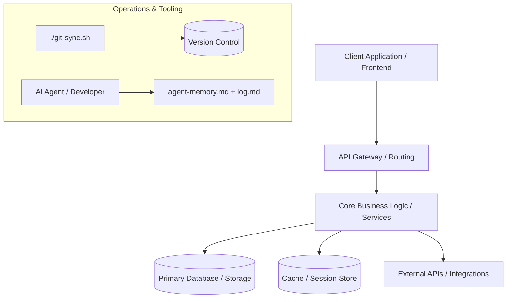

# 🧠 Agent Memory — Universal UI Themes

> [!IMPORTANT]
> **Purpose**: This file provides persistent architectural context, directory governance, and technical decisions for AI agents and human engineers.
> **Protocol**: Read this file at the start of any task. Update Section 4 (Architecture Decisions) and Section 7 (Roadmap & Status) whenever architectural choices or milestones change.

---

## 1. Project Identity

| Field | Value |
|---|---|
| **Project Name** | Universal UI Themes |
| **Description** | Zero-Dependency Vanilla CSS Design Tokens & 22 Production Theme Presets |
| **Primary Stack** | Pure Vanilla CSS Custom Properties, HTML5, Bash Bundler |
| **Primary Branch** | `main` (or `core`) |
| **Repository URL** | https://github.com/North-Abyss/ui-themes |
| **Lead / Author** | Yuvanesh KS (@North-Abyss) |
| **Target Platforms** | Web, Mobile, Desktop, Framework-Agnostic (React, Vue, Svelte, Astro, HTML) (e.g. Web / Desktop / Mobile / Cloud) |

---

## 2. Reading Priority
Before executing any task, consult files in this exact sequence:
1. [AGENTS.md](AGENTS.md) — Strict operating constraints & safety guardrails.
2. [agent-memory.md](agent-memory.md) — Directory map and active architecture.
3. [log.md](log.md) — Recent dev sessions and what changed last.
4. [TODO.md](TODO.md) / Issue tracker — Current backlog and priorities.

---

## 3. Directory Governance Map

> Detailed specification: [docs/guides/directory_governance_guide.md](docs/guides/directory_governance_guide.md)  
> Workspace scratchpad policy: [workspace/README.md](workspace/README.md)

| Path | Purpose | Put Here | Never Put Here |
|---|---|---|---|
| `src/frontend/` | Storefront / Client UI | Presentation components, pages, reactive hooks, UI routing | Direct DB connections, backend logic |
| `src/backend/` | Application & API Server | Route controllers, services, middleware, domain models | Client DOM logic, UI styling |
| `src/database/` | Data & Persistence Layer | Schemas, migrations, repositories, seed scripts | Presentation logic, external HTTP calls |
| `src/integrations/` | 3rd Party Connectors (ACL) | External APIs (Zoho, Razorpay, Stripe, AWS), webhooks | Raw UI widgets, frontend imports |
| `src/shared/` | Shared Utilities & Contracts | Common DTOs, cross-stack types, pure helper functions | Environment-dependent DB or DOM code |
| `src/themes/` | Global Theme Tokens | CSS variables, typography scales, design system tokens | Page-specific one-off styles |
| `specs/` | Task Specifications | Contract-first specifications (<100 lines) | Code implementations |
| `docs/architecture/` | Architectural deep dives | System diagrams, RFCs, trade-off analysis | Scratch notes or raw code dumps |
| `docs/guides/` | Team & developer guides | Setup guides, deployment runbooks, FAQs | Transient experiment notes |
| `scripts/dev/` | Development automation | Local seeders, linters, generators, test helpers | Production deploy logic |
| `scripts/deployment/` | Build & deployment ops | Release bundlers, CI helpers, container pushes | Untested experimental scripts |
| `config/mcp/` | Universal MCP Templates | Playwright, DevTools, Stitch, Memory, Fetch | Production credentials |
| `config/docker/` | Containerization configs | Dockerfiles, `compose.yml`, multi-stage builds | Production secrets or API keys |
| `config/environments/` | Environment definitions | `.env.example`, staging/prod config templates | Real credentials or `.env` files |
| `tests/unit/` | Fast automated unit tests | Component, unit, and isolated logic tests | Long-running network tests |
| `tests/e2e/` | Integration and E2E tests | End-to-end user flows, API integration suites | Throwaway testing scripts |
| `workspace/` | Local scratch area (git-ignored) | Experiments, reference clones, log dumps | Production or tracked codebase |
| `workspace/audit/` | Visual audits & headless screenshots | Playwright/Chrome headless theme renders, UI audits | Permanent tracked documentation |
| `workspace/tmp/` | Disposable test scripts | Quick Python/Node test scripts, debug logs, JSON dumps | Application source code, permanent configs |
| `workspace/repos/` | Cloned reference repos | Upstream repos, competitor code to inspect | Nested git submodules, project code |
| `workspace/docs/` | Local uncommitted notes | Rough scratch notes, downloaded PDF/HTML manuals | Official team documentation, ADRs |
| `workspace/archive/` | Historical stash | Discarded prototypes, old code snippets | Active code, living documentation |

---

## 4. Architectural Decisions Record (ADR)
Record significant architectural choices here (Date, Decision, Reason, Trade-offs):

- **ADR-001 [{{INITIAL_DATE}}]: Project Initialization**
  - **Decision:** Adopted universal project template structure.
  - **Context:** Bootstrapped repository using standardized directory governance and AI agent integration guidelines.
  - **Status:** APPROVED.

- **ADR-002 [2026-10-14]: Modular Source Architecture & Layered Governance**
  - **Decision:** Partitioned `src/` into 6 isolated layers (`frontend/`, `backend/`, `database/`, `integrations/`, `shared/`, `themes/`) with strict Anti-Corruption Layer (ACL) and theme token rules.
  - **Context:** Standardize code organization across multi-stack projects (e.g. ECOM-SAA, PT) to prevent circular imports, isolate external vendor APIs, and prevent design token drift.
  - **Status:** APPROVED. Standard documented in `src/ARCHITECTURE.md` and `docs/architecture/codebase_architecture_policy.md`.

- **ADR-003 [2026-10-21]: Directory Governance & Workspace Scratchpad Standard**
  - **Decision:** Formalized full directory governance in `docs/guides/directory_governance_guide.md` and created `workspace/README.md` with explicit subdirectories (`archive/`, `docs/`, `repos/`, `tmp/`). Configured `.gitignore` to track directory scaffolding while ignoring all scratch contents.
  - **Context:** Clarify directory boundaries for developers and AI agents, preventing scratch file pollution and submodule nesting.
  - **Status:** APPROVED.

- **ADR-004 [2026-10-24]: Universal UI Theme Engine & 10 Production Presets**
  - **Decision:** Implemented 10 plug-and-play UI theme presets in `src/themes/presets/` (Material 3, Minimal 2D B&W, Glassmorphism, Claymorphism, Neo-Brutalism, Neumorphism, Cyberpunk, Bento Modern, Retro 90s, OLED Pure Black) backed by token primitives and switchable via `<html data-theme="...">`. Built an interactive component kitchen sink (`src/themes/showcase.html`) and visual catalog (`docs/guides/ui_theme_catalog.md`). Documented model economics in `docs/guides/antigravity_token_optimization_guide.md`.
  - **Context:** Elevate PT with elite multi-paradigm UI design tokens and safeguard Antigravity AI model quotas against rapid exhaustion.
  - **Status:** APPROVED.

- **ADR-005 [2026-10-29]: What & Why Code Documentation Standard & Template Tooling Sync**
  - **Decision:** Codified the "What & Why" function documentation contract requiring all exported symbols to document operational behavior (WHAT) and architectural rationale (WHY). Created `doc-governance` on-demand skill, `verify_code_rules.py` auditor, `verify_template.mjs` directory governance validator, and `agent-rules.md` universal extended conventions. Expanded `run.sh` with `--audit` and `--clean`, `git-sync.sh` with `--skip-ci` and `--watch`, and updated upstream managed assets in `update-template.sh`.
  - **Context:** AI agents frequently delete edge-case guards and refactor critical code without understanding the business rationale. Structured docblocks with explicit WHY sections (`@remarks` in TS/JS, `[WHY]` in Python/Dart) prevent this by giving agents the architectural context they need before modifying code.
  - **Status:** APPROVED.

- **ADR-006 [2026-10-29]: MCP Audit Artifact Governance, Antigravity Hooks & Advanced Skills**
  - **Decision:** Confined all Playwright/Chrome/MCP visual audit artifacts into `workspace/audit/` with automated purge in `./run.sh --clean`. Integrated native Antigravity lifecycle hooks (`.agents/hooks.json`) with `scripts/dev/hook_safety_gate.py` to intercept destructive commands (`git reset --hard`, `git clean`, `rm -rf`, force-push). Created `db-migrator` and `security-auditor` skills. Expanded `config/mcp/mcp_config.template.json` and `setup_mcp.sh` with GitHub, SQLite, Context7, and Sequential Thinking profiles.
  - **Context:** Tech community feedback across Reddit (`r/mcp`, `r/ClaudeAI`) and GitHub highlights the danger of context window bloat from too many active MCPs, the need for clean transient scratch areas, and the necessity of safety guardrails preventing agents from executing irreversible shell actions.
  - **Status:** APPROVED.

- **ADR-007 [2026-10-30]: Lean Server Deployment Architecture & Tauri v2 Desktop Compilation**
  - **Decision:** Codified lean server deployment patterns (`scripts/deployment/deploy_server.sh` + `config/ci/deploy-server.yml`) using Capistrano-style atomic symlinks (`releases/`, `shared/`, `current -> releases/<timestamp>`), offloaded builds with zero compiler tooling on production hosts, and systemd supervision with graceful shutdown draining. Standardized static hosting via GitHub Actions (`config/ci/pages.yml`) and `scripts/deployment/deploy_gh_pages.sh`. Codified web-to-desktop application packaging harness in `packaging/desktop/` using Tauri v2 (capability security, cross-platform `lib.rs` + `main.rs`, and multi-platform CI matrix).
  - **Context:** Modern cloud setups waste server memory and risk build-time OOM failures when running compilers on target hosts. Decoupling build from code-only deployment ensures stability, predictability, and minimal server footprints. Tauri v2 provides ultra-lightweight binaries (~10 MB, ~40 MB RAM) over bloated Electron instances.
  - **Status:** APPROVED.

- **ADR-008 [2026-10-30]: Context Shielding, Remote Safety Gate, Native Git Hooks & Product Blueprint**
  - **Decision:** Implemented AI context window shielding via `.cursorignore` and `.agentignore` to strip 250+ KB lockfiles and build directories, cutting agent token consumption by 50–80%. Enhanced `hook_safety_gate.py` to intercept unauthorized remote network commands (`ssh`, `scp`, `rsync.*@`). Established zero-dependency native pre-commit quality gate (`.githooks/pre-commit` via `git config core.hooksPath .githooks`). Created zero-dependency environment variable parity auditor (`scripts/dev/verify_env.py`). Introduced canonical high-level product blueprint template (`docs/APP_SPEC.md.template`) and full-stack Docker Compose starters in `config/docker/` mounting `./workspace/data`.
  - **Context:** Cross-project audit of downstream repositories (`ggs-hotelMS`, `ECOM-SAA`, `Project-Proteus`) revealed real-world friction where agents wasted tokens parsing lockfiles, projects lacked high-level product architecture templates, and agents risked executing remote SSH commands without human confirmation.
  - **Status:** APPROVED.

- **ADR-009 [2026-11-01]: Universal Theme Engine, UI Modular Studio & SEO / 4:5 Social Preview**
  - **Decision:** Codified 22 production theme presets (8 Light, 7 Dark & Spatial, 7 Legendary Developer themes) in pure CSS with `--theme-name` and `--theme-mode` tokens. Integrated UI Modular Studio with desktop side-by-side docking (`body.studio-docked { padding-right: 460px; }` with zero backdrop dimming) for unobstructed live editing, real-time token sliders, live HTML & CSS injection, and standalone export. Added a 3-way Mode Switcher (`System`, `Light`, `Dark`) with OS media query listener. Configured full SEO suite with canonical URL `https://north-abyss.github.io/ui-themes/` and an exact 4:5 aspect ratio (1080x1350) social preview card (`assets/social-preview-4x5.png`). Provided downstream sync client (`sync-ui-themes.sh`) and integrated automated GitHub Pages deployment into `git-sync.sh` (`--deploy-gh-pages`).
  - **Context:** User requirements for a production-grade UI design system template with live interactive customization, authentic developer theme reproduction (Tokyo Night, Catppuccin, Dracula, GitHub Dark), clean mode defaults, and seamless downstream project synchronization.
  - **Status:** APPROVED.

---

## 5. System Architecture Diagram

---

## 6. Coding & Tooling Conventions
- **Naming Conventions:** Use stack idioms (e.g. PascalCase for components/classes, camelCase or snake_case for functions).
- **Environment Management:** All environment variables must have a corresponding entry with placeholder values in `config/environments/.env.example`.
- **Formatting & Linting:** Run project standard formatters before committing.
- **Git Syncing:** Always commit and sync using `./git-sync.sh`.

---

## 7. Development Roadmap & Status
- **Current Phase:** Phase 0 — Project Setup & Architecture Scaffolding
- **Active Milestones:**
  - [x] Template initialization and directory structure
  - [x] Universal UI theme engine (22 presets: 15 morphisms + 7 famous developer themes with Google Icons)
  - [x] What & Why documentation standard & governance tooling (8 on-demand skills, verify_template.mjs, verify_code_rules.py)
  - [x] MCP audit artifact governance (`workspace/audit/`), Antigravity lifecycle hooks (`.agents/hooks.json`), and 10 on-demand skills
  - [ ] Core environment and dependency setup
  - [ ] Minimum Viable Product (MVP) feature implementation
  - [ ] Testing and continuous integration setup
  - [ ] Initial release preparation

---

## 8. Historical Context & Change Tracking
- Refer to [log.md](log.md) for detailed chronological dev sessions.
- Refer to [CHANGELOG.md](CHANGELOG.md) for formal tagged release notes.
